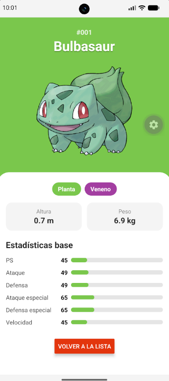

# PokeDex Explorer

PokéDex Explorer es una aplicación móvil que desarrollé con React Native y Expo para consultar información de Pokémon a través de la PokéAPI.

La aplicación permite recorrer una lista de Pokémon, buscarlos por nombre o número y consultar su información en una ficha con imagen, tipos, altura, peso y estadísticas base. También implementé la carga de más Pokémon al desplazarse por la lista y mensajes para manejar errores o búsquedas sin resultados.

**Estudiante:** Andrés Salazar Castrillón

## Tecnologías utilizadas

- React Native y Expo
- JavaScript
- `fetch` y `async/await` para las consultas a la API
- `react-native-safe-area-context` para adaptar la interfaz a la pantalla

## Cómo está organizado el proyecto

Organicé el código en varias carpetas para mantener separadas las pantallas, los componentes y la lógica que maneja los datos. Así puedo encontrar más fácilmente cada parte de la aplicación y modificarla sin tener todo mezclado en un mismo archivo.

- **`services/`:** aquí están las consultas a la PokeAPI.
- **`hooks/`:** contienen la lógica para cargar la lista y consultar el detalle de cada Pokémon.
- **`screens/`:** tienen las dos pantallas principales de la aplicación.
- **`components/`:** guardan los elementos que reutilizo, como las tarjetas, el buscador y las barras de estadísticas.
- **`constants/`:** contiene los colores, las traducciones y otros valores que utiliza la aplicación.
- **`utils/`:** contiene funciones auxiliares para dar formato a los datos.

`App.js` conecta las pantallas principales y `src/` reúne el resto del código de la aplicación.

## Algunas decisiones que tomé

- **Usar `FlatList`:** la elegí para mostrar los Pokémon en dos columnas y cargar más elementos al acercarse al final de la lista.
- **Separar la lógica de las pantallas:** así puedo manejar las consultas y sus estados sin llenar los componentes de código relacionado con la API.
- **Controlar los errores:** agregué mensajes para los problemas de conexión y las búsquedas sin resultados, además de la opción de volver a intentar.
- **Conservar la lista al abrir una ficha:** oculto la lista en lugar de desmontarla para mantener la posición del scroll y los Pokémon que ya se habían cargado.
- **Permitir búsquedas por nombre o número :** la aplicación limpia los espacios sobrantes y convierte el texto a minúsculas antes de buscar.

## Capturas de pantalla
| Cargando | Exito |
|---|---|
|  |  |
| Error | Sin Resultados |
|---|---|
|  |  |

## Reflexión del proyecto

Con este proyecto comprendí mejor cómo funciona una API y cómo puedo utilizarla para obtener información y mostrarla en una aplicación.